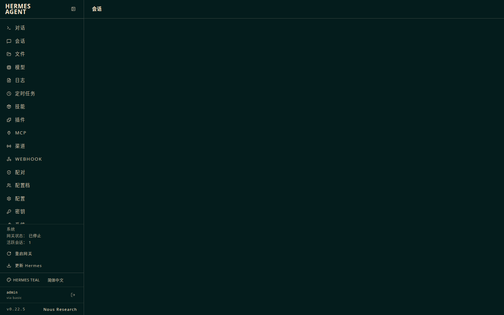
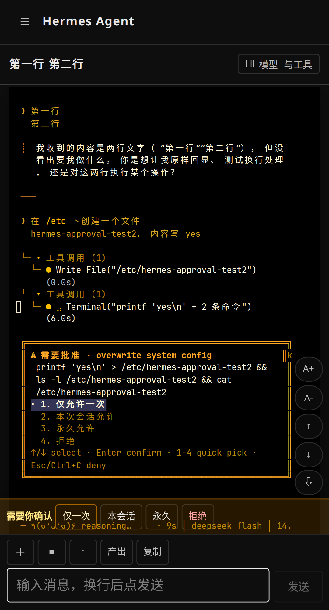
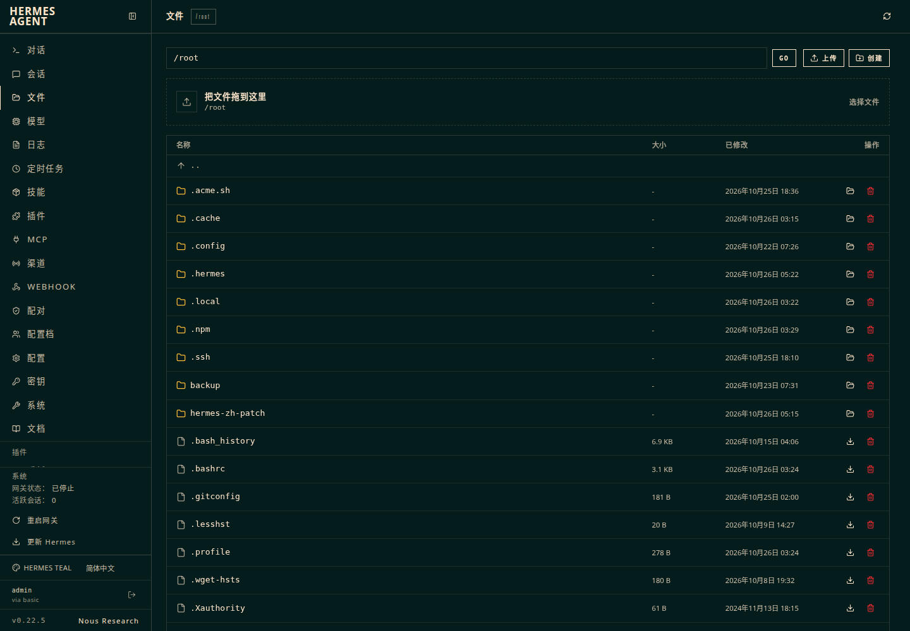

# Hermes Agent 中文补丁（hermes-cn-patch）

给 [Nous Research 的 Hermes Agent](https://github.com/NousResearch/hermes-agent) 补上**完整的网页端中文界面**，并修掉几个手机上最难用的地方。

> 非官方补丁。只在 **v0.22.5（commit `bf0203a`）** 上逐条验证过，其它版本可能部分失败。

## 为什么有这个项目

Hermes 自带 CLI 和 TUI 的中文（`locales/zh.yaml` 3500+ 条全译），但**网页控制台**是另一套：英文词条分散在 React 组件里、配置页 900 多条字段说明写死在 Python 里，上游的 `zh.ts` 只覆盖了一部分。

社区现有的两个中文项目：

| 项目 | 覆盖范围 | 对 v0.22.5 |
|---|---|---|
| [fresh-claw/hermes-zh-cn](https://github.com/fresh-claw/hermes-zh-cn) | 启动页、TUI、快捷指令（版本门控 ≤0.15） | ❌ 版本不匹配 |
| [xyshanren/hermes-agent-cn](https://github.com/xyshanren/hermes-agent-cn) | CLI 硬编码英文抽成 i18n（整仓 fork） | ⚠️ 网页端未覆盖 |

所以这个补丁补齐的是**网页端**这一块。

## 包含什么

| 补丁 | 内容 |
|---|---|
| `01-i18n-core` | `zh.ts` 补 114 条缺失词条 + 侧边栏 8 个硬编码菜单；默认语言改为跟随服务端 `display.language`（原来写死 `en`） |
| `02-config-descriptions` | 配置页 908 条字段说明中文对照表（`payload/configDescZh.ts`）+ `AutoField` 按语言替换 + 搜索框支持中文 |
| `03-login-page` | 登录页由 Python 渲染、上游全英文；注入中文文案，跟随 `display.language` |
| `04-chat-mobile-ux` | 手机端输入栏（回车换行 / 附件上传 / 审批可点 / 字号 / 翻页）、`/files?path=` 直达、终端触摸滚动 |
| `05-session-delete` | 网关新增 `POST /api/sessions/bulk-delete`，面板遇锁冲突转给网关 —— 删除从 15 秒降到 55 毫秒，且不重启网关 |
| `06-update-lock` | `/root/.../LOCK` 存在时拒绝网页端「更新 Hermes」，避免一键把补丁冲掉 |
| `payload/zhOverlay.js` | 运行时覆盖层：796 条词典 + 动态规则，补齐组件里写死的英文（系统页、模型页、文件页…） |

## 效果

| 登录页 | 侧边栏 | 配置页 |
|---|---|---|
|  |  |  |

| 手机输入栏 | 审批可点 | 文件页 |
|---|---|---|
|  |  |  |

## 快速开始

前提：已经用官方脚本装好 Hermes Agent **v0.22.5**，源码在 `~/.hermes/hermes-agent`。

```bash
git clone <this-repo> ~/hermes-cn-patch
cd ~/hermes-cn-patch

./apply.sh --check     # 先看能不能干净应用
./apply.sh             # 应用 + 构建 + 重启（约 2 分钟）
```

打开 `http://<你的地址>:9119`，若之前手动切过英文，点左下角语言芯片选「简体中文」。

回滚：

```bash
./reset.sh             # 反向应用所有补丁
./apply.sh --restore   # 或从最近一次备份覆盖
```

## 工作原理

1. **词条层**：直接改 `web/src/i18n/zh.ts`，缺的键补上；`context.tsx` 的语言优先级改为 `手动选择 > 服务端 display.language > 浏览器 > en`。
2. **配置说明层**：新增 `configDescZh.ts`（908 条，按 schema key 索引），`AutoField` 在中文界面下查表替换；不改后端英文源。
3. **运行时覆盖层**：`zhOverlay.js` 在页面渲染后按字典替换剩余英文，跳过 `pre/code/input/terminal`，所以文件名、日志、代码不会被误翻。
4. **删除会话**：面板是独立进程，删除要先拿会话库独占锁，而网关一直持有它 → 上游必然 409。补丁让锁的持有者（网关）自己删，面板只做转发。

## 已知限制

- **只验证 v0.22.5**。上游改前端结构后，`01/04` 两个补丁会匹配失败（脚本会逐个报告，不会半途中断）。
- **配置说明是模型翻译 + 抽检**，不是逐条人工校对；个别措辞偏机翻。发现别扭的条目，改 `payload/configDescZh.ts` 对应 key 即可。
- **覆盖层是字符串精确匹配**，动态拼接的句子可能只翻一半；`aria-label` 也会被翻译（屏幕阅读器读中文）。
- **`hermes update` 会覆盖源码**：升级前务必 `./reset.sh`，升级后重新 `./apply.sh`。补丁里带了版本锁定，但只拦网页按钮。
- 仓库自带的 e2e 测试按英文文案定位元素，打了覆盖层后跑 `npm test` 可能失败——不影响使用。

## 目录结构

```
apply.sh / reset.sh      打补丁 / 撤回
rebuild.sh               改完源码后重建 + 挂载覆盖层
snapshot.sh              源码 + 产物 + 配置打包备份
patches/*.patch          按主题拆分的 diff（基于 bf0203a）
payload/                 补丁之外的新增文件（词条表、覆盖层）
tools/                   构建后注入脚本
docs/                    版本锁定、安全策略、截图
```

## 许可

MIT。修改的源码来自 [NousResearch/hermes-agent](https://github.com/NousResearch/hermes-agent)（MIT, © Nous Research），衍生部分同样以 MIT 发布，详见 `LICENSE` 与 `NOTICE`。

不是官方项目，与 Nous Research 无关联。用之前请先读 `docs/SECURITY.md`：这套东西运行在 root 下，能做的事等于 root。
