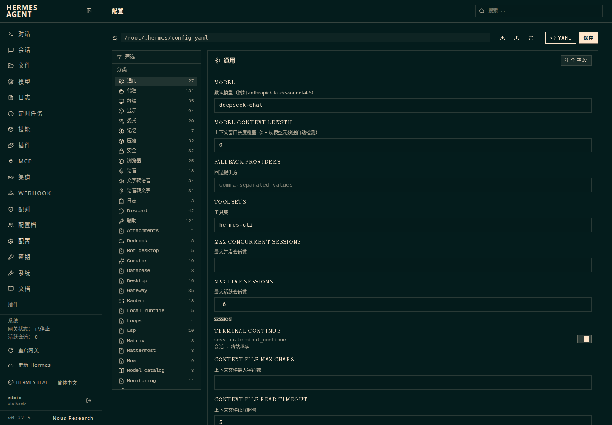
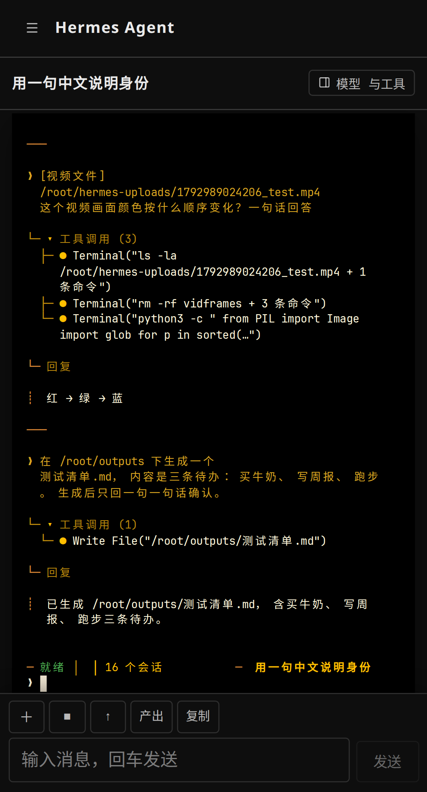

# Hermes Agent 中文补丁（Linux 云服务器版）

给 [Nous Research 的 Hermes Agent](https://github.com/NousResearch/hermes-agent) 装上**完整中文的网页控制台**，并修掉手机上最难用的几处。面向 **Linux 云服务器**：解压 → 跑一条命令 → 浏览器打开就是中文。

> **先看这个**：界面汉化有更省事的方式——装插件 [hermes-zh](https://github.com/wond03/hermes-zh-plugin)。不用构建、`hermes update` 不会冲掉、覆盖 2600+ 条文案（含配置说明和插件市场简介）。
>
> 只有这几种情况才需要本补丁：① 手机端要可见输入栏和发图；② 删除会话报 409；③ 「更新 Hermes」在锁定状态下误执行；④ 登录页也要中文。
>
> 非官方补丁，基于 **v0.22.5（commit `bf0203a`）** 逐条验证。

## 一条命令装完

```bash
# 已经装好 Hermes Agent（~/.hermes/hermes-agent 存在）
sudo ./install.sh
```

没装 Hermes？加一个参数，脚本会先跑官方安装再打补丁：

```bash
sudo ./install.sh --install-hermes
```

安装完会打印：

```
控制台：http://<你的公网IP>:9119
用户名：admin
密码：  <随机生成，或沿用你原来设置的>
```

## 装完你会得到什么

| 位置 | 之前 | 现在 |
|---|---|---|
| 登录页 | 全英文（后端 Python 渲染） | 中文，跟随 `display.language` |
| 侧边栏 | 文件/MCP/渠道/Webhook… 硬编码英文 | 全部中文 |
| 配置页 | 908 条字段说明全英文 | 中文说明，搜索框支持中文关键词 |
| 系统页/模型页/文件页 | 组件里写死英文 | 796 条运行时词典覆盖 |
| 手机对话页 | 只能敲终端、不能发图片 | 输入栏：换行、附件上传、审批按钮、字号、翻页 |
| 删除会话 | 必报 409（网关占锁） | 55ms 删除，不重启网关 |

| 登录页 | 配置页 | 手机输入栏 |
|---|---|---|
|  |  |  |

## 脚本做了什么

1. **体检**：系统/架构/磁盘/内存/npm 可达性
2. **定位**：找 `~/.hermes/hermes-agent`，校验 commit
3. **打补丁**：`git apply` 6 个按主题拆分的 diff（可重复执行，已打的会跳过）
4. **构建**：`npm run build` → 挂载运行时词典 + PWA 清单
5. **常驻**：创建 systemd 服务 `hermes-dashboard`（已存在则不动）
6. **登录**：没设密码就生成一个随机密码并打印

约 2 分钟。前端依赖已随 Hermes 装好，正常不需要额外装包。

## 防火墙 / 安全组

```bash
# Ubuntu/Debian
ufw allow 9119/tcp
# CentOS/RHEL
firewall-cmd --add-port=9119/tcp --permanent && firewall-cmd --reload
```

**云厂商安全组**（阿里云、腾讯云、华为云…）还要在控制台加一条：入站 `TCP:9119`，源 `0.0.0.0/0` 或你的固定 IP。这一步脚本做不了。

## 常用操作

```bash
sudo ./install.sh --check     # 只体检，不动系统
sudo ./install.sh --no-build  # 只打源码，不构建
sudo ./reset.sh               # 撤掉补丁，恢复上游原样
sudo ./uninstall.sh           # 撤补丁（加 --service 连服务一起停）
sudo ./rebuild.sh             # 改完源码后重建 + 挂词典 + 重启
```

升级 Hermes 前**务必先** `./reset.sh`，升级后再 `./apply.sh`（或重跑 `install.sh`）。

## 兼容性

| 项目 | 状态 |
|---|---|
| Ubuntu 24.04 x86_64 | ✅ 实测（补丁就是在这台腾讯云机器上开发验证的） |
| Debian 12 / Ubuntu 22.04 | ✅ 理论可行（同 systemd + apt 体系，未单独跑） |
| CentOS / Rocky / Alma | ⚠️ 需 `firewalld` + 自己装 node/npm，脚本未适配 |
| aarch64 云主机 | ⚠️ 补丁与架构无关，但 Hermes 官方 arm 包未验证 |
| Hermes 其它版本 | ❌ 仅 v0.22.5 验证；新版可能补丁匹配失败（脚本逐个报告，不会半途中断） |

## 常见问题

**npm registry 不可达，构建失败**
配国内镜像：`npm config set registry https://registry.npmmirror.com`，再重跑 `./install.sh`。

**1G 内存的机器构建被 OOM 杀掉**
加 swap：`fallocate -l 2G /swapfile && chmod 600 /swapfile && mkswap /swapfile && swapon /swapfile`。

**9119 被占用**
换端口：`sudo PORT=9120 ./install.sh`。

**忘记密码**
```bash
hermes config set dashboard.basic_auth.password '新密码'
systemctl restart hermes-dashboard
```

**想回到英文**
`./reset.sh` 然后 `cd ~/.hermes/hermes-agent/web && npm run build`，重启服务。

## 安全提醒

Hermes 的网页控制台本质是一个**能执行命令的终端**，默认以 root 运行。装上这个补丁不改变这一点。请至少做到：

- 不要用弱密码；只在自己可信的网络上开放端口
- 想彻底收敛暴露面：面板只监听 `127.0.0.1`，用 SSH 隧道访问（`ssh -L 9119:127.0.0.1:9119 root@你的IP`）
- 读一遍 [`docs/SECURITY.md`](docs/SECURITY.md)：审批层怎么配、哪些路径被硬拦

## 目录结构

```
install.sh          一键安装（体检 → 补丁 → 构建 → 服务 → 密码）
apply.sh            只打补丁（可被 CI 或其它脚本调用）
reset.sh            反向应用，恢复上游
uninstall.sh        撤补丁 / 连服务一起停
rebuild.sh          改完源码后重建
patches/            6 个按主题拆分的 diff（基于 bf0203a）
payload/            补丁之外的新增文件（908 条配置说明、796 条运行时词典）
tools/              构建后注入脚本、补丁导出脚本
docs/               安全策略、版本锁定、截图
```

## 许可

MIT。修改的源码来自 [NousResearch/hermes-agent](https://github.com/NousResearch/hermes-agent)（MIT, © Nous Research），以 diff 形式提供；衍生部分同样 MIT，详见 `LICENSE` 与 `NOTICE`。

与 Nous Research 无关联，未获其背书。
